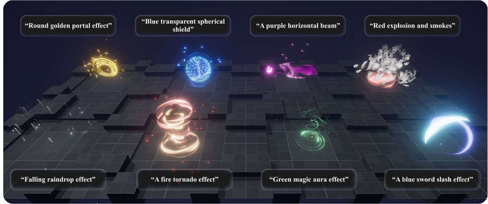

# SpeLL

**A Generative Framework for Synthesizing 3D Visual Effects from Text Prompts with Large Language Models**  
Jeongseok Oh and SeungJun Kim · HCIS Lab, GIST · **UIST 2026**

[Project page](https://stan5dard.github.io/SpeLL-project/) · [Paper (PDF)](docs/paper/SpeLL.pdf) · [ACM / DOI](https://doi.org/10.1145/3830398.3830697) · [Video](https://stan5dard.github.io/SpeLL-project/#video)

> **Code coming soon.** We are preparing the implementation and documentation for public release. This repository currently hosts the project page, paper, rendered results, and the planned code structure. It does not yet contain a runnable implementation.

[](https://stan5dard.github.io/SpeLL-project/)

## Overview

SpeLL creates **editable 3D VFX drafts from natural-language prompts**. It combines large language models with retrieval-based asset assembly, coordinating meshes, tileable noise textures, and particle systems in Unity.

- **Prompt enhancement:** expand a high-level request into component descriptions and spatial-temporal guidance.
- **Spatial and temporal design:** select components, arrange their positions and sizes, and refine their activation sequence.
- **Editable output:** produce parameterized VFX drafts that designers can refine through familiar Unity controls.

A formative study with professional VFX designers informed the framework. A user study with twenty professional designers evaluated SpeLL against ablated systems, 3D generation baselines, and manual workflows. See the paper for the study design, findings, and limitations.

## Release status

The paper, project page, and demonstration videos are available. Implementation, setup instructions, and data preparation guidance are being prepared. **No release date is announced yet.**

## Repository structure

```text
SpeLL-project/
├── docs/                # GitHub Pages project website, paper, and rendered media
├── unity/               # Placeholder for the Unity client
├── server/              # Placeholder for backend generation and retrieval modules
├── data/                # Placeholder for data schemas and preparation instructions
├── scripts/             # Placeholder for setup and preprocessing utilities
├── CITATION.cff
└── MAINTAINING.md        # Website updates and implementation release workflow
```

The implementation directories intentionally contain only short README files until release.

## Citation

```bibtex
@inproceedings{oh2026spell,
  author    = {Oh, Jeongseok and Kim, SeungJun},
  title     = {SpeLL: A Generative Framework for Synthesizing 3D Visual Effects
               from Text Prompts with Large Language Models},
  booktitle = {Proceedings of the 39th Annual ACM Symposium on
               User Interface Software and Technology},
  series    = {UIST '26},
  year      = {2026},
  publisher = {Association for Computing Machinery},
  doi       = {10.1145/3830398.3830697},
  url       = {https://doi.org/10.1145/3830398.3830697}
}
```

## License and assets

The paper is distributed under [CC BY 4.0](https://creativecommons.org/licenses/by/4.0/), as stated in the paper. The implementation license and dependency notices will be provided with the code release. Rendered research demonstrations do not grant redistribution rights to the underlying third-party asset packs; these packs are not included in this repository.
